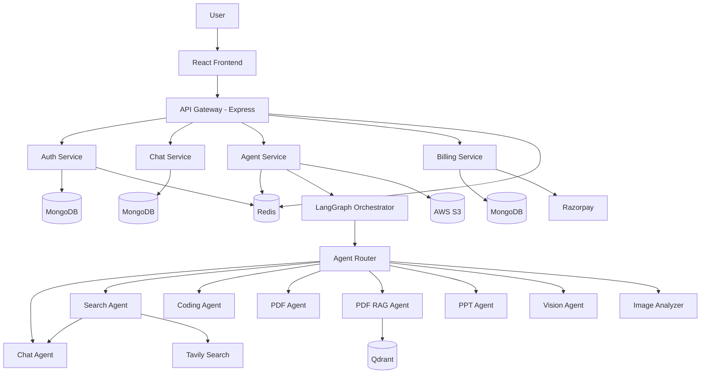
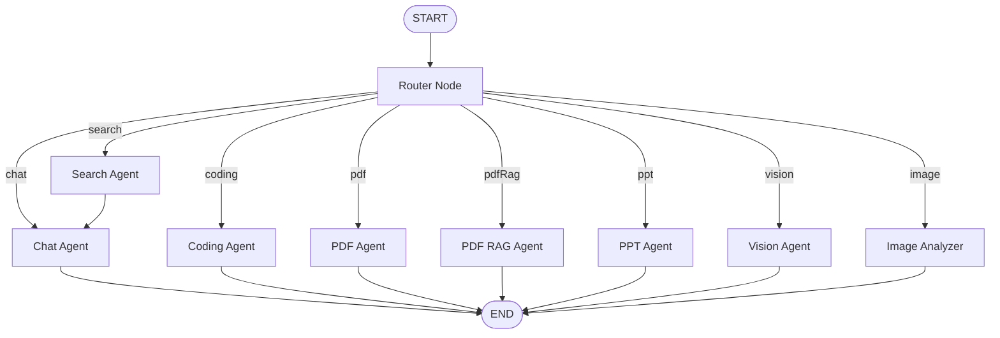
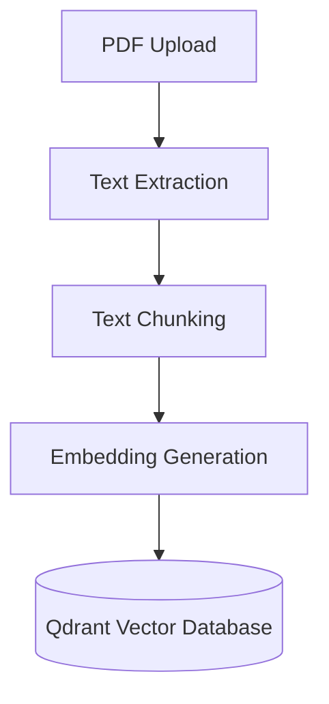
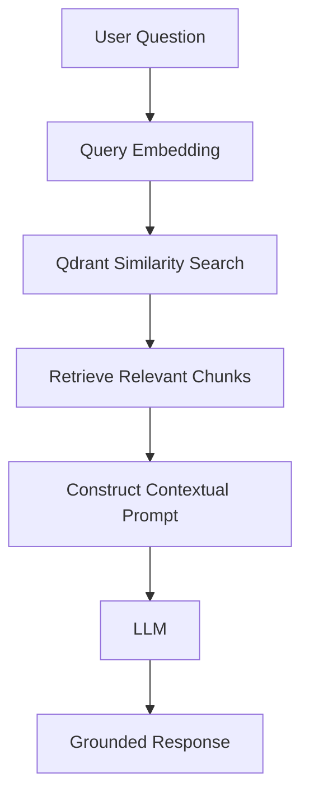
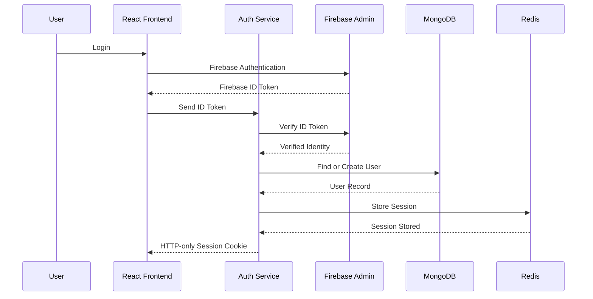
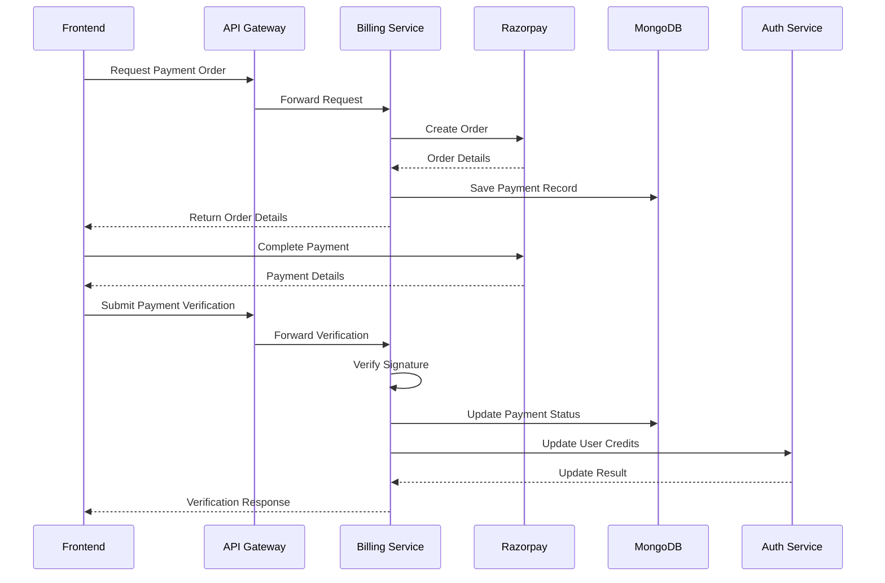

# CortexAI — Multi-Agent AI Workspace

### An intelligent AI platform powered by LangGraph, RAG, and a microservices architecture.

CortexAI is a full-stack, multi-agent AI application designed to bring conversational AI, intelligent coding assistance, web search, document understanding, presentation generation, and multimodal capabilities into one unified workspace.

Instead of relying on a single LLM for every task, CortexAI uses **LangGraph-based orchestration** to route incoming requests to specialized AI agents. Each agent is responsible for a particular category of work, allowing the application to handle different tasks through a modular and extensible architecture.

The platform is built using a React frontend and a distributed Node.js/Express backend consisting of an API Gateway and four independent microservices: Auth, Chat, Agent, and Billing.

---

## Table of Contents

- [Overview](#overview)
- [Core Features](#core-features)
- [Technology Stack](#technology-stack)
- [System Architecture](#system-architecture)
- [Backend Architecture](#backend-architecture)
- [Multi-Agent Architecture](#multi-agent-architecture)
- [How LangGraph Works](#how-langgraph-works)
- [RAG Pipeline](#rag-pipeline)
- [Authentication and Session Management](#authentication-and-session-management)
- [Conversation Memory](#conversation-memory)
- [File and Artifact Management](#file-and-artifact-management)
- [Billing and Credit Management](#billing-and-credit-management)
- [Frontend Architecture](#frontend-architecture)
- [Project Structure](#project-structure)
- [Request Lifecycle](#request-lifecycle)
- [Installation and Setup](#installation-and-setup)
- [Environment Variables](#environment-variables)
- [Running the Application](#running-the-application)
- [Docker and Deployment](#docker-and-deployment)
- [Security Considerations](#security-considerations)
- [Future Improvements](#future-improvements)

---

## Overview

CortexAI aims to provide a unified environment where users can interact with multiple specialized AI capabilities without switching between different applications.

The application uses an intelligent routing mechanism to determine which agent should process a user's request.

For example:

- A general question is handled by the Chat Agent.
- A request requiring current information is processed by the Search Agent.
- A software development request is routed to the Coding Agent.
- A document-related question can be processed through the PDF RAG pipeline.
- A presentation request is handled by the PPT Agent.
- A visual question can be processed by the Vision Agent.
- An uploaded image can be sent to the Image Analyzer.

The backend separates authentication, conversation persistence, AI orchestration, and payment processing into independent services.

This separation makes the application modular, easier to maintain, and more convenient to extend with additional AI capabilities.

---

## Core Features

### 1. Multi-Agent AI Orchestration

- LangGraph-based agent orchestration.
- Intelligent routing of incoming user requests.
- Automatic agent selection.
- Support for explicit agent selection.
- Specialized agents for different categories of tasks.
- Shared state management across the graph workflow.

### 2. AI Conversational Chat

- Context-aware conversational responses.
- Conversation history management.
- Redis-backed short-term conversation memory.
- Persistent message storage using MongoDB.
- Integration with configurable LLM providers.

### 3. AI Coding Assistant

- Code generation.
- Code explanation.
- Code debugging.
- Code review.
- Code optimization.
- Code conversion.
- Technical documentation generation.
- Structured multi-file project generation.
- Interactive code viewing through Monaco Editor.

The Coding Agent classifies the user's programming request into a specific intent before generating the appropriate response.

### 4. Web Search Agent

- Integration with Tavily Search.
- Retrieval of relevant web search results.
- Context forwarding to the conversational agent.
- LLM-based synthesis of retrieved information.

### 5. PDF Processing and RAG

- PDF file uploads.
- Document text extraction.
- Text chunking.
- Embedding generation.
- Vector storage using Qdrant.
- Semantic similarity search.
- Context-aware question answering over uploaded documents.

### 6. Document Generation

- AI-powered PDF generation.
- PowerPoint presentation generation.
- Downloadable generated artifacts.
- AWS S3-based artifact storage.

### 7. Multimodal Capabilities

- Image uploads.
- AI-powered image analysis.
- Vision-based model integration.
- Image-related AI workflows.

### 8. Authentication and User Management

- Firebase Authentication.
- Firebase Admin SDK token verification.
- MongoDB user persistence.
- Redis-backed session management.
- HTTP-only session cookies.
- Protected backend routes.

### 9. Credit-Based Billing

- Razorpay payment integration.
- Payment order creation.
- Backend payment verification.
- Payment history persistence.
- Credit deduction for AI operations.

---

## Technology Stack

### Frontend

| Technology | Purpose |
|---|---|
| React | Component-based user interface |
| Vite | Frontend development and build tooling |
| Redux Toolkit | Global application state management |
| Firebase Authentication | User authentication |
| Axios | HTTP communication with backend |
| Monaco Editor | Interactive code artifact editor |
| React Markdown | Rendering AI-generated Markdown |
| CSS | Application styling |

### Backend

| Technology | Purpose |
|---|---|
| Node.js | JavaScript runtime |
| Express.js | REST API development |
| MongoDB | Persistent application data |
| Mongoose | MongoDB object modeling |
| Redis | Sessions, caching and short-term memory |
| Firebase Admin SDK | Backend identity verification |
| LangChain | LLM integration and AI utilities |
| LangGraph | Multi-agent workflow orchestration |
| Multer | File upload handling |
| Axios | Internal service communication |

### AI and Retrieval

| Technology | Purpose |
|---|---|
| LLM Providers | Conversational and specialized AI inference |
| LangGraph | Agent routing and state management |
| LangChain | Model and retrieval integrations |
| Google Gemini Embeddings | Text embedding generation |
| Qdrant | Vector database |
| Tavily | Web search integration |

### Cloud and Infrastructure

| Technology | Purpose |
|---|---|
| AWS S3 | Generated artifact storage |
| Razorpay | Payment processing |
| Docker | Service containerization |
| Docker Compose | Local infrastructure orchestration |
| GitHub Actions | CI/CD automation |
| AWS EC2 | Application deployment target |

---

## System Architecture

CortexAI follows a microservices architecture with a central API Gateway.

The frontend communicates with the Gateway rather than directly communicating with individual backend services.



### Microservices

| Service | Responsibility |
|---|---|
| API Gateway | Central entry point, authentication middleware and request forwarding |
| Auth Service | Firebase verification, user management and session handling |
| Chat Service | Conversation and message persistence |
| Agent Service | AI agent execution, LangGraph orchestration and artifact processing |
| Billing Service | Payment processing and credit management |

Each service maintains its own application logic and exposes HTTP endpoints for communication.

---

## Backend Architecture

### 1. API Gateway

The API Gateway is the entry point for frontend API requests.

Its responsibilities include:

- Receiving frontend HTTP requests.
- Validating authentication sessions.
- Reading HTTP-only session cookies.
- Retrieving session information from Redis.
- Identifying the authenticated user.
- Forwarding requests to the appropriate microservice.
- Propagating authenticated user information through internal headers.

The `proxyWithHeader.js` utility handles request forwarding and authenticated header propagation.

The Gateway helps keep internal service addresses and implementation details separate from the frontend.

### 2. Auth Service

The Auth Service handles application authentication and user management.

Responsibilities include:

- Verifying Firebase ID tokens through Firebase Admin SDK.
- Finding or creating application users in MongoDB.
- Maintaining user records using Firebase UID.
- Creating Redis-backed sessions.
- Setting HTTP-only authentication cookies.
- Invalidating sessions during logout.
- Supporting application credit-related operations where implemented.

Firebase handles the identity provider functionality, while MongoDB stores application-specific user information.

### 3. Chat Service

The Chat Service manages persistent conversation data.

Responsibilities include:

- Creating conversations.
- Retrieving conversation history.
- Updating conversation details and titles.
- Saving user messages.
- Saving assistant responses.
- Persisting generated images and artifacts associated with messages.

MongoDB provides permanent conversation storage, while Redis is used separately for frequently accessed recent conversation context.

### 4. Agent Service

The Agent Service contains the core AI functionality.

Responsibilities include:

- Receiving AI requests.
- Processing optional file uploads.
- Invoking the LangGraph workflow.
- Routing requests to specialized agents.
- Managing conversation context.
- Communicating with Chat and Auth services.
- Deducting credits where required.
- Generating PDF and PowerPoint artifacts.
- Uploading generated files to AWS S3.
- Returning AI responses and artifacts.

### 5. Billing Service

The Billing Service handles payments and credit-related operations.

Responsibilities include:

- Maintaining payment records.
- Managing available plans.
- Creating Razorpay payment orders.
- Verifying payment signatures.
- Updating payment status.
- Communicating with the appropriate service for user credit updates.

Separating billing logic from the Agent Service keeps payment processing independent of AI execution.

---

## Multi-Agent Architecture

The Agent Service uses LangGraph to coordinate specialized agents.

Instead of implementing every capability inside a single large function, individual agents are maintained as separate modules.

### Available Agents

| Agent | Responsibility |
|---|---|
| Chat Agent | General conversational responses |
| Search Agent | Web search and information retrieval |
| Coding Agent | Programming assistance and project generation |
| PDF Agent | PDF-related document processing and generation |
| PDF RAG Agent | Retrieval-augmented question answering over PDFs |
| PPT Agent | PowerPoint presentation generation |
| Vision Agent | Vision-related AI processing |
| Image Analyzer | Understanding uploaded images |

### Automatic Routing

When a user submits a request, the router determines which agent should handle it.

The routing process considers:

1. Whether the user explicitly selected an agent.
2. Whether an uploaded file is present.
3. The MIME type of the uploaded file.
4. The intent of the user's prompt.

When automatic selection is used, the routing LLM determines the appropriate agent for the request.

For example:

```text
User: Explain how a binary search tree works.

        |
        v

   LangGraph Router

        |
        v

     Chat Agent

        |
        v

   AI Response
```

A coding request follows a different path:

```text
User: Build a complete React todo application.

        |
        v

   LangGraph Router

        |
        v

    Coding Agent

        |
        v

  Intent Classification

        |
        v

  Code Generation

        |
        v

 Structured Project Files

        |
        v

  Artifact Response
```

The Search Agent can pass retrieved information to the Chat Agent for final response synthesis.

This separates information retrieval from conversational response generation.

---

## How LangGraph Works

LangGraph provides the orchestration layer for the multi-agent system.

The workflow is organized around three major concepts.

### 1. State Schema

The state schema defines the information shared across the graph.

The application maintains state properties for information such as:

- User prompt.
- AI response.
- Selected agent.
- Conversation ID.
- Search results.
- Generated images.
- Artifacts.
- User ID.
- Uploaded file.

The state is initialized when the controller invokes the graph.

### 2. Router Node

The router determines which agent should execute next.

It evaluates the incoming state and returns a routing decision.

### 3. Agent Nodes

Each specialized agent operates on the shared graph state.

An agent processes the relevant information and returns state updates.

The graph then follows the configured edges until execution reaches its end node.

### Simplified Workflow



The exact transitions are configured in the graph implementation.

The important distinction is that the Express route handles the HTTP request, while LangGraph controls the internal AI execution workflow.

---

## RAG Pipeline

CortexAI includes a Retrieval-Augmented Generation pipeline for answering questions based on uploaded PDF documents.

Rather than relying exclusively on the language model's existing knowledge, the RAG pipeline retrieves relevant document content and provides it as context to the model.

### Document Ingestion



### Retrieval and Generation



### Key Components

**Text Extraction**

The uploaded PDF is processed to extract its textual content.

**Text Chunking**

The extracted content is divided into smaller chunks using text-splitting utilities.

This makes retrieval more manageable and allows the system to select relevant portions of a document.

**Embedding Generation**

The text chunks are converted into vector representations using the configured embedding model.

**Vector Storage**

Qdrant stores the embeddings and associated document content.

**Similarity Search**

When a user asks a question, the query is embedded and compared with the stored vectors.

The most relevant chunks are retrieved.

**Contextual Generation**

The retrieved chunks are passed to the LLM as context so it can generate an answer based on the uploaded document.

---

## Authentication and Session Management

CortexAI uses Firebase Authentication for identity management and Redis-backed sessions for backend authentication.

### Login Flow



### Subsequent Requests

The browser automatically sends the session cookie with eligible requests.

The Gateway:

1. Reads the session cookie.
2. Retrieves the corresponding session from Redis.
3. Validates the session.
4. Attaches authenticated user information to the request.
5. Forwards the request to the appropriate internal service.

The authenticated user ID is propagated to downstream services through internal headers.

### Why Redis?

Redis provides fast access to session information without requiring the Gateway to query MongoDB for every authenticated request.

---

## Conversation Memory

CortexAI uses both MongoDB and Redis for conversation management.

They serve different purposes.

| Component | Responsibility |
|---|---|
| MongoDB | Permanent conversation and message storage |
| Redis | Short-term conversation memory and caching |

### Conversation Lifecycle

1. A user creates or selects a conversation.
2. The frontend sends the conversation ID with subsequent messages.
3. The Chat Service persists messages in MongoDB.
4. The Agent Service retrieves relevant previous conversation context.
5. Recent messages are maintained in Redis.
6. The AI agent uses this context to generate a response.
7. The assistant response is persisted through the Chat Service.

This design allows the application to maintain conversation continuity while keeping permanent storage separate from short-term memory.

---

## File and Artifact Management

CortexAI supports file uploads and generated artifacts.

### File Uploads

Multer handles multipart file uploads in the Agent Service.

The uploaded file can be passed into the appropriate workflow based on its type and the request.

Examples include:

- PDF documents.
- Images.

### Artifact Generation

The application supports structured artifacts generated by specialized agents.

Examples include:

- Multi-file coding projects.
- PDF documents.
- PowerPoint presentations.

### AWS S3

AWS S3 is used for generated artifact storage.

The Agent Service contains utilities for:

- Uploading artifacts.
- Retrieving stored objects.
- Generating accessible signed URLs where implemented.

The frontend can display generated coding artifacts through its artifact interface.

---

## Billing and Credit Management

CortexAI integrates Razorpay for payment processing.

The Billing Service maintains payment-related logic separately from AI execution.

### Payment Lifecycle



### Credit Deduction

The Agent Service integrates with the appropriate credit-management endpoint before or during AI operations according to the original implementation.

This allows the application to associate AI usage with the user's available credits.

---

## Frontend Architecture

The frontend is built with React and Vite.

It uses Redux Toolkit for managing global application state and Axios for communicating with the backend.

### Component Responsibilities

| Component | Responsibility |
|---|---|
| `App.jsx` | Root application component |
| `Home.jsx` | Main application workspace |
| `ChatArea.jsx` | Active conversation interface |
| `ChatInput.jsx` | User prompt input, agent selection and file upload |
| `MessageList.jsx` | Displays conversation messages |
| `MessageBubble.jsx` | Renders individual AI and user messages |
| `Artifact.jsx` | Displays generated coding artifacts |
| `BillingDrawer.jsx` | Payment and credit interface |
| `SideBar.jsx` | Conversation navigation |
| `Nav.jsx` | Main navigation interface |
| `LoadingAnimation.jsx` | Loading and processing feedback |

### Frontend API Features

The `features/` directory separates backend API operations from presentation components.

It includes:

- `createConversation.js`
- `createOrder.js`
- `getConversations.js`
- `getCurrentUser.js`
- `getMessages.js`
- `logOut.js`
- `sendMessage.js`
- `updateConversation.js`
- `verifyPayment.js`

### Redux State Management

Redux is organized into separate slices:

- `userSlice.js`
- `conversationSlice.js`
- `messageSlice.js`

The Redux store combines these slices to maintain application state across components.

### HTTP Communication

Axios is configured centrally in:

`frontend/utils/axios.js`

This allows API requests to share the configured backend base URL and credential behavior.

---

## Project Structure

```text
CortexAI/
│
├── .github/
│   └── workflows/
│       └── deploy.yml
│
├── backend/
│   │
│   ├── gateway/
│   │   ├── controllers/
│   │   │   └── user.controller.js
│   │   ├── middleware/
│   │   │   └── auth.middleware.js
│   │   ├── utils/
│   │   │   └── proxyWithHeader.js
│   │   ├── Dockerfile
│   │   ├── index.js
│   │   ├── routes.js
│   │   └── package.json
│   │
│   ├── services/
│   │   │
│   │   ├── agent/
│   │   │   ├── agents/
│   │   │   │   ├── chat.agent.js
│   │   │   │   ├── coding.agent.js
│   │   │   │   ├── imageAnalyzer.agent.js
│   │   │   │   ├── pdf.agent.js
│   │   │   │   ├── pdfRag.agent.js
│   │   │   │   ├── ppt.agent.js
│   │   │   │   ├── search.agent.js
│   │   │   │   └── vision.agent.js
│   │   │   │
│   │   │   ├── config/
│   │   │   │   ├── agentLimit.js
│   │   │   │   ├── db.js
│   │   │   │   ├── embeddings.js
│   │   │   │   ├── llmModels.js
│   │   │   │   ├── memory.js
│   │   │   │   ├── multer.js
│   │   │   │   ├── s3.js
│   │   │   │   ├── tavily.js
│   │   │   │   └── vectorDb.js
│   │   │   │
│   │   │   ├── controllers/
│   │   │   │   └── agent.controller.js
│   │   │   │
│   │   │   ├── graph/
│   │   │   │   ├── graph.js
│   │   │   │   ├── router.js
│   │   │   │   └── state.js
│   │   │   │
│   │   │   ├── routes/
│   │   │   │   └── agent.route.js
│   │   │   │
│   │   │   ├── utils/
│   │   │   │   ├── deductCredits.js
│   │   │   │   ├── generatePdf.js
│   │   │   │   ├── generatePpt.js
│   │   │   │   ├── getFromS3.js
│   │   │   │   ├── getMessages.js
│   │   │   │   └── uploadToS3.js
│   │   │   │
│   │   │   ├── Dockerfile
│   │   │   ├── index.js
│   │   │   └── package.json
│   │   │
│   │   ├── auth/
│   │   │   ├── config/
│   │   │   │   ├── db